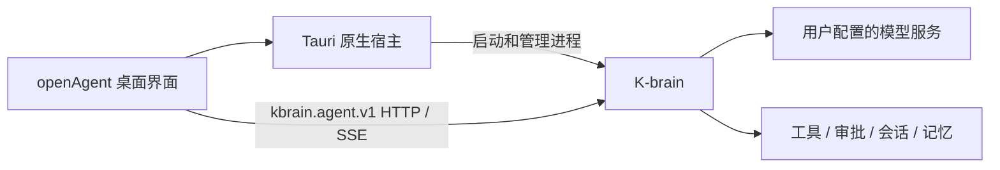

# openAgent 开发基线与后续清单

记录日期：2026-11-26。产品版本：`0.1.0-dev.0`。

当前产品范围与最新验证见 [本地桌面调整说明](OPENAGENT_LOCAL_DESKTOP.md)：窗口默认 1159 × 857，右侧工作台默认收起，移除远程/SSH/WebUI/语音输入/云同步，新增 8 个中文内置角色模板。下文各次改动的测试数字是对应历史批次的记录。

## 已确认的方向

- 产品名为 **openAgent**，开发目录为 `D:\Desktop\openAgent\openAgent`。
- 桌面沿用 LiveAgent 的 React/TypeScript + Tauri/Rust 结构。
- Agent 后端继续直接使用 **K-brain**：模型调用、Agent 执行、工具、审批、会话和记忆均沿用它的能力。不创建自有后端，不对 K-brain 进行产品改名。
- 相邻 `LiveAgent`、`K-brain` 目录用于上游参考；产品改动只在 openAgent 仓库进行。
- 本文取代初始 `AGENTDESKTOP_DEVELOPMENT_CHECKLIST.md` 中尚未确定的产品名和“自有后端/后端重新品牌化”建议。初始清单是改造前的检查记录，不能作为当前实现状态。



## 基线来源与边界

| 项目 | 当前约定 |
| --- | --- |
| LiveAgent 基线 | `9d254a41`，保留原 Git 历史，产品分支 `product/openagent` |
| K-brain 源码基线 | `02cd80037809790478281e986a2d3b1004737c32` |
| K-brain Windows 制品 | 锁定源码加 `openagent-roles.patch` 本地编译，校验补丁和二进制 SHA-256；原 `v0.107.47` 下载记录保留供无补丁配置使用 |
| 协议 | `kbrain.agent.v1`，保留既有协议和工具名称 |
| 桌面身份 | `com.oao11.openagent`，二进制名 `openAgent` |
| 产品默认数据 | `%USERPROFILE%\.openagent` |
| 桌面更新 | 默认未配置，等待产品自己的发布仓库和签名公钥 |
| Git 远程 | `liveagent` 指向用户 fork；尚未配置 openAgent 的发布远程仓库 |

内部 Rust/JS 包名 `liveagent`、`@liveagent/*`、Gateway 二进制名和部分通信命名保留。工作区中的 `.liveagent`、`.liveagent-subagents` 等约定可能由 K-brain 的保护规则和工具消费，不能只凭品牌替换它们。

K-brain 仍由 `scripts/release/kbrain.lock.json` 锁定。直接修改相邻 K-brain 参考目录不会自动替换运行中的后端。后续升级先确认协议和权限能力兼容，再更新源码/制品锁和校验值并回归测试。

## 已实施

- [x] 建立独立产品工作区和 `product/openagent` 分支，保留上游历史。
- [x] Go 升级到 1.27.0，仓库 `mise.toml` 对齐。
- [x] 桌面名称、窗口、托盘、关于页、主要中英文文案和图标改为 openAgent；Windows 专用配置和图标资源同步对齐。
- [x] 浏览器扩展展示名称、数据迁移文件夹、记忆路径提示和配置导出名称对齐。
- [x] 集中解析产品数据目录，桌面配置与 K-brain 使用相同的根目录。
- [x] 不自动迁入 LiveAgent/K-brain 的历史个人数据。
- [x] 原生开发调试桥只监听 `127.0.0.1`，仅 Debug 注册，Release 不启用。
- [x] 停用上游桌面更新源；更新检查与安装要求产品自己的仓库和公钥。
- [x] Windows 卸载清理目标改为 `.openagent`。
- [x] 更新桌面测试的产品名、开发隔离变量和执行文件路径。
- [x] 修正权限集成测试的 Windows 命令与隔离用户目录，保留审批和沙箱断言。
- [x] 保留 LiveAgent MIT 声明，保存 K-brain Apache-2.0 许可并加入打包资源。

## 数据隔离约定

桌面数据根目录优先级为：`OPENAGENT_CONFIG_DIR` → `OPENAGENT_HOME` → 默认根目录中的迁移指针 → `%USERPROFILE%\.openagent`。前两个变量必须为绝对路径；显式空值或相对路径会使存储初始化失败。旧产品的 `LIVEAGENT_HOME`、`K_BRAIN_HOME`、`LIVEAGENT_CONFIG_DIR` 不再控制 openAgent 桌面数据根目录。

K-brain 子进程仍接收它支持的 `LIVEAGENT_HOME` 和 `-data-dir`，值是桌面解析后的 openAgent 数据目录。这是兼容既有后端的内部调用约定。

`OPENAGENT_DEV_HOME` 仅在 Debug 构建生效，用于原生验收隔离。浏览器扩展和 worktree 位于默认根目录下，完整的开发隔离优先指定此变量。Tauri/WebView 的缓存可能仍按应用标识使用系统应用数据目录；它与 `.openagent` 中的会话和配置数据不同。隔离验收不等于证明操作系统中完全没有该应用的缓存。

安装包的“删除应用数据”只清理默认 `.openagent`。迁移目录的删除、安装升级和卸载还需单独验收。

## Windows 开发环境

本机实际使用 Go 1.27.0、Node 24.13.0、pnpm 10.32.1、Rust/Cargo 1.97.1、protoc 29.3。Go 安装目录为 `D:\software\GO`，旧版本保留于 `D:\software\GO-backup-1.26.3-openagent`。

原生构建需要 MSVC/C++ Build Tools、WebView2，以及供 `rquickjs`/bindgen 使用的 libclang。`LIBCLANG_PATH` 应指向包含 `libclang.dll` 的目录。本机已配置用户级变量为 `D:\software\openAgent-tools\libclang`；新终端生效。其他机器应设置自己的 LLVM 路径，不要照搬本机目录。

```powershell
Set-Location D:\Desktop\openAgent\openAgent
# 本机已打开的旧终端可显式补入；新终端会继承用户环境变量
$env:LIBCLANG_PATH = [Environment]::GetEnvironmentVariable('LIBCLANG_PATH', 'User')
npx.cmd --yes pnpm@10.32.1 install --frozen-lockfile
npx.cmd --yes pnpm@10.32.1 dev
```

```powershell
# Debug 桌面应用，嵌入生产前端，不生成安装包
npx.cmd --yes pnpm@10.32.1 --filter liveagent tauri build --debug --no-bundle
# 完整 Release 构建和安装包；需另行验证安装/升级/卸载
npx.cmd --yes pnpm@10.32.1 build
# 单独构建界面和 Gateway
npx.cmd --yes pnpm@10.32.1 build:gui
npx.cmd --yes pnpm@10.32.1 prepare:gateway
# 前端与产品关键路径测试
npx.cmd --yes pnpm@10.32.1 test:gui
cargo test -p liveagent --lib openagent --locked
```

当前角色功能需从锁定源码应用补丁构建 K-brain；首次准备需要可访问源码仓库和 Go 模块源，也可以通过 `build-kbrain-source.mjs --source-dir ..\K-brain` 使用相邻参考仓库的已锁定提交。如需代理，只在自己的终端设置代理变量。不要提交代理凭据或模型 API Key。

## 本次验证记录

详细日志和隔离数据在 Git 忽略目录 `.openagent-validation/`。下列状态以实际命令结果为依据，后续修改后应重新核对。

| 检查 | 结果 / 证据 |
| --- | --- |
| Go 1.27.0 | `go version` 与真实 Gateway 编译通过 |
| 依赖安装 | pnpm 10.32.1，`--frozen-lockfile` 通过 |
| 桌面和 Gateway 前端 | TypeScript 检查和 Vite 构建通过；保留上游 CSS 优化警告 |
| K-brain 独立启动 | 鉴权健康检查 200；未鉴权 401；协议与 revision 匹配；关闭父进程 stdin 后退出码 0，见 `kbrain-smoke.json` |
| Windows 权限集成 | 13 项通过，含工作区沙箱执行与保护目录拒写，见 `permission-isolated.log` |
| 原生相关单元测试 | 33 项通过，覆盖数据根、迁移、更新和托盘，见 `native-related.log` |
| 前端完整发现范围 | 684 个文件、8 个批次、4,832 项检查已执行；原始失败经修复后集中复测 58 项：57 通过、0 失败、1 项环境限制跳过，见 `frontend-fixed-final.log`。原始批次另有 4 项既有跳过 |
| 原生桌面构建和启动 | 最终 Debug / no-bundle 构建通过，真实窗口与首次引导加载成功，鉴权、数据目录、更新配置和调试桥检查通过，正常退出码 0；见下方验收补充 |

Windows 目录信任的符号链接场景因创建目录符号链接返回 `EPERM` 跳过，需要在具备相应系统权限的环境另行验收。未启用系统开发者模式或修改个人目录权限。全量原始批次日志保留历史失败，最终结论结合定向复测；未声称同一次全量命令零失败。

权限集成测试使用本地模型响应 fixture 驱动真实 K-brain 工具执行。这证明协议和权限链的相应场景，不代表真实云模型服务已经联调成功。

## 原生桌面验收补充

2026-11-26 最后一轮 Debug 构建及启动复测通过。构建产物为 `target/debug/openAgent.exe`，完整日志在 `.openagent-validation/desktop-build-final.log`。最后一次增量编译复用此前已完成的前端、Gateway 和真实 K-brain 制品，通过临时 Tauri 配置跳过重复的 `beforeBuildCommand`；没有使用替代后端。

隔离验收由 `.openagent-validation/desktop-smoke.mjs` 启动实际桌面程序，并在临时用户目录中检查：

- 应用名和主窗口标题为 `openAgent`，标识为 `com.oao11.openagent`，版本为 `0.1.0-dev.0`。
- 主界面和七步首次引导正常显示；当前没有配置模型服务。
- 桌面启动的 K-brain 鉴权健康检查返回 200，未鉴权请求返回 401；后端版本与 revision 对应锁文件。
- 桌面和后端共用临时用户目录下的 `.openagent`，生成真实的配置、会话、记忆等存储。
- 更新状态为 `configured=false`，没有连接上游桌面更新源。
- 开发调试桥实际监听 `127.0.0.1`，报告为 `loopback only`。源码通过 `#[cfg(debug_assertions)]` 限制桥的注册；Release 构建及运行尚未验证。
- 通过应用退出命令正常关闭，退出码为 0；验收后未留下 openAgent 桌面进程。

结构化报告见 [desktop-smoke.json](../.openagent-validation/desktop-smoke.json)，实际窗口截图见 [desktop-smoke.png](../.openagent-validation/desktop-smoke.png)。这些验收文件由 Git 忽略，只保存在本地。验收回传使用短期本地 HTTP fixture，未增加生产能力权限，也不在报告中保存后端鉴权令牌。

当前产物用于本机开发，请保留 `target/debug` 下配套的后端、Gateway 和资源文件。真实模型任务、Release 安装包、安装/升级/卸载，以及全部扩展能力仍需分别验收；Debug 启动通过不能代替这些结果。

## 工作台定制与单一预览验收（2026-11-26）

本节记录基础产品验收之后的工作台修改，以此处说明为当前行为：

- 右侧工具选择和新建菜单移除“新建内网穿透”和“新建 SSH 连接”，旧配置中的对应标签、排序和激活项也会清理，避免同步后重新出现。
- 左侧不再提供“图像工作台”入口，也不能通过旧的导航开关重新显示。
- 不再自动生成 Default Project；首次启动没有默认工作空间，也不创建 `default-project` 目录。旧默认条目从配置中移除，其路径加入隐藏列表，避免历史发现再次加回。已有文件、会话及用户自行添加的项目保留。
- 每次启动默认打开右侧工作台，仍可手动收起。
- 输入框下方统计栏使用可换行的文字布局；新增输入、输出、缓存读取和缓存写入显示。“统计显示项”提供 12 个选项和恢复默认按钮，本机保存可见性选择；没有对话数据时仍可配置。输入总量包含缓存读写，缓存读写是其中的明细。
- `preview:build` 固定更新 `target/debug/openAgent.exe`，只维护一个本地预览版本，不生成 Release 安装包或带时间戳的预览副本。后端、电脑操作和 Gateway 的 exe 是该预览所需的配套程序，必须保留。

| 验证 | 结果与本地证据 |
| --- | --- |
| 前端类型检查 | 通过，`workbench-typecheck.log`；最终预览构建也完成前端类型检查和打包 |
| 前端回归 | 较大范围执行 975 项，最初 969 通过、6 失败；旧行为断言已更新，全局工作目录回归已修复。相关 6 个测试文件定向复测 197 项全部通过，0 失败、0 跳过；见 `workbench-regression.log`、`workbench-tests-final.log` |
| 原生设置回归 | `cargo test -p liveagent --lib commands::config_commands::settings::tests --locked`：99 通过、0 失败、1 项既有真实 WebDAV 账号测试忽略；见 `workbench-native-tests-final.log` |
| 唯一本地预览构建 | `npx.cmd --yes pnpm@10.32.1 preview:build` 通过，包含正常 beforeBuild 流程；见 `workbench-preview-build.log` |
| 实际桌面验收 | 新隔离目录启动同一 exe，默认展开、移除入口、无默认工作空间/目录、12 项统计配置、勾选保存、重开弹层和恢复默认均通过；正常退出码 0 |
| K-brain 联通 | 同一桌面启动的真实后端健康检查：鉴权 200、未鉴权 401；保持既有 K-brain 协议和后端 |

验收脚本及日志在 `.openagent-validation/`，结果见 [workbench-smoke.json](../.openagent-validation/workbench-smoke.json)，主界面和统计配置截图分别见 [workbench-smoke.png](../.openagent-validation/workbench-smoke.png)、[workbench-stats-options.png](../.openagent-validation/workbench-stats-options.png)。隔离验收未配置云模型；用量汇总由前端轨迹测试覆盖，真实供应商返回的用量仍取决于其提供的数据。验收脚本没有修改生产权限，也没有输出后端令牌。

## 统计栏对齐修复（2026-11-26）

用户在有实际统计数据时发现数字与文字错位，并且最后一个吞吐指标单独居中换行。复现使用与截图一致的读数：2 轮、2 步、输入 3.9 万、输出 334、缓存读取 2.3 万、TTFT 6.9 秒和 263 tok/s。

原因是 `RollingStatText` 的数字窗口只有 `1em` 高，`.stat-number` 使用 `vertical-align: bottom`，而统计行使用更高的行高；12px 字号下，原生窗口测得数字框中心比文字框低 4.5px。另一个原因是统计项容器使用 `flex-wrap` 和 `justify-center`，每一行分别居中，造成末行单项飘在中间。

修复将滚动文本内部的标签、单位、数字统一为同一行高并垂直居中，保留词段间空格和数字动画。状态容器改用纵向 flex，消除 Tooltip 行内包装额外引入的基线间隙。每项最小高度与设置按钮一致，统计项间距收紧；换行保持共同左边界，继续保留全部选中指标和可见性配置。生产代码仅调整 `ConversationStatsBar.tsx` 和 `styles/animations.css`。

相关既有测试 31 项通过，包含数字更新复用、心跳、手动压缩确认、统计可见性保存和用量汇总；两处源码的 Biome 检查通过。日志见 `.openagent-validation/stats-alignment-tests.log`、`stats-alignment-lint.log`。修复前的原生截图与布局测量保存在 `stats-layout-before.png`、`stats-layout-before.json`。

使用实际 React 组件输出的 DOM 和预览包内 CSS，在隔离桌面窗口中验证 960、740、685、520、360px 宽度，以及 520px 宽/15px 字号，共 6 组。每组均检查 12 项完整显示、数字与标签中心差不超过 0.5px、换行左边界一致、设置按钮与首行中心一致、无横向溢出。该 fixture 的统计数据由验收脚本提供，不代表一次云模型调用；没有修改用户聊天或配置。最终 `preview:build` 完成后重新运行原生验收，6 组布局全部通过；实测标签与数字中心差为 0px，应用正常退出码 0。统计显示项操作和工作台入口验收同时通过。最终报告与截图见 `.openagent-validation/stats-layout-after.json`、`stats-layout-after.png`，构建日志见 `stats-alignment-build.log`。继续覆盖同一个 `target/debug/openAgent.exe`。

## 工作区与系统设置调整（2026-11-26）

工作空间标题栏的分享入口及话题菜单中的分享项已移除。置顶和更多按钮原先使用 `relative` 但继承了基础按钮的 `top-1.5`，导致垂直偏移；改为正常 flex 布局中的 `static` 后，真实桌面中的两个按钮中心与话题标题中心一致。

桌面启动 K-brain 时将原生检测到的 IANA 系统时区传入 `TZ`。这解决了 K-brain 在 Windows 上无法通过 `/etc/localtime` 自动检测而回退 UTC 的问题。新配置保持自动模式；已有用户手动选择的时区仍由 K-brain 保存并优先使用。供应商设置的导入入口、新增/编辑供应商中的用量查询入口已移除，旧配置字段继续兼容读取。

提示词页面改为父对话全局模板与子代理角色的独立开关：全局最多一个，角色可启用多个。编辑器提供名称、描述、角色开关、可用供应商模型、Thinking 与推理档位，右侧为大文本编辑区和字符计数。模型或档位不支持的选项会受能力限制；未选择角色模型时沿用默认子代理模型。小窗口下编辑器纵向排列且正文可滚动，保存按钮固定在底部。设置打开时暂停右侧工作台的窄窗口抽屉，避免遮挡编辑器；关闭设置恢复原展开状态。

参考仓库 `wnnz/LiveAgent-custom` 已只读检出并审查，revision 为 `4eb6a4a89a5a49ffa0ebcde69f6b0fad373a6ad2`。该版本默认 `agents: []`，模板定义只包含 id/name/description/prompt/enabled；未找到截图中八个角色的内置提示词，也没有对应角色模型配置。因此没有向真实用户配置中写入臆造模板。验收截图中的三个模板是隔离测试数据。

角色执行仍由 K-brain 完成。`patches/kbrain/openagent-roles.patch` 为锁定版本增加模板角色字段、API 持久化、父对话可选角色目录以及既有 `subagent` 工具的 `role` 参数。角色提示词只进入选择该角色的子代理；角色指定的模型和推理档位优先于调用参数；禁用/不存在的角色和不可解析模型明确失败。工具权限沿用现有子代理逻辑。构建步骤和维护要求见 [补丁说明](../patches/kbrain/README.md)。

验证记录：

- 相关前端回归 166 项全部通过，涵盖设置归一化、存储、提示词后端、自动时区、侧栏和供应商表单。见 `settings-frontend-tests.log`。
- K-brain 的 resources/prompts/agent/backend 四个包定向测试通过。见 `settings-kbrain-tests.log`。
- 真实 K-brain API 与本地模型响应 fixture 验证了角色保存、重启恢复和实际子代理请求的角色提示词、模型、推理参数。与打包测试合计 16 项：14 通过，2 项 Unix 执行位检查在 Windows 跳过。见 `settings-role-integration.log`。这不代表真实云供应商联调。
- 窄窗口工作台遮挡回归及既有侧栏测试 8 项全部通过；GUI/WebUI 类型检查和所改 TS 文件的 Biome 检查通过。见 `settings-compact-tests.log`、`settings-webui-typecheck.log`、`settings-lint.log`、`settings-compact-lint.log`。

最终 `preview:build` 成功，继续覆盖唯一的 `target/debug/openAgent.exe`（2026-11-26 15:34:32）。配套 K-brain 的 revision、补丁和二进制校验通过。构建日志为 `.openagent-validation/settings-preview-final-build.log`。

最终 exe 在新隔离配置中的原生验收通过，正常退出码 0：首次启动的时区偏好为空（自动），实际/系统时区均为 `Asia/Shanghai`；鉴权健康检查 200、匿名请求 401；分享、供应商导入和用量查询入口均不可见；话题与置顶/更多按钮中心差为 0px；模板编辑、字符计数、保存重开、全局唯一性及角色独立开关通过。原生窗口分别检查 1400×800、884×641 和 684×641 的实际 WebView 尺寸：两栏/单栏布局无横向溢出，保存按钮无遮挡，窄窗口可滚动到完整提示词编辑区，外层卡片完整包含输入框。验收没有修改用户的模型配置或聊天数据。

报告与截图：`.openagent-validation/settings-smoke.json`、`settings-template-list.png`、`settings-template-editor.png`、`settings-template-editor-compact.png`、`settings-template-editor-narrow.png`、`settings-template-editor-narrow-prompt.png`。同目录的 `settings-smoke.mjs` 可复验实际预览程序；窗口尺寸由隔离验收进程的原生窗口调整，未增加生产 Tauri 权限。

## 后续开发清单

1. **首个真实任务闭环**：配置用户自己的模型服务，选择工作区，提交任务，审批实际工具调用，检查文件产物，重启后恢复会话。记录取消、失败和恢复行为。
2. **后续产品体验**：本节工作台定制已完成。继续按用户要求调整后续页面、目标任务、Agent 模板、首次引导和结果展示，调用现有 K-brain API。
3. **扩展功能验收**：按实际需要验收 MCP、Skills、浏览器自动化、电脑操作和计划任务。复用现有能力不等于所有能力在 Windows 均已验收。
4. **发布工程**：配置独立产品远程仓库、发行版本、更新签名与发布流程；审查继承的 GitHub 工作流。完成 Release、NSIS、安装/升级/卸载和数据迁移验收，再启用更新源。
5. **上游维护**：成对记录 LiveAgent 基线和 K-brain 锁，定期取回变更、审查协议差异并回归。fork 的存在不能代替兼容性验证。

本次没有提交、推送或发布代码，也没有配置模型凭据。发布签名、真实模型验收和安装包验收保留为明确待办。


## Skills 商店与内置审查技能更新（2026-11-26）

当前内置代码审查技能名为 `openagent-code-review`。目录/关键词搜索的 K-brain 修复、旧技能安全迁移、补丁哈希和实际 EXE 验收结果见 `OPENAGENT_LOCAL_DESKTOP.md` 的“Skills 改名与商店修复”小节。继续开发时保留这部分补丁；普通空关键词商店浏览必须使用 ClawHub 目录接口，并保留排序、每页数量和分页游标。仅覆盖 `target/debug/openAgent.exe` 这一份本地预览。


## Skills 中文译文（2026-11-26）

Skills 商店结果和技能详情已加入按需中文翻译，复用 K-brain 既有无工具文本接口，支持选择模型、原文切换、分段翻译、取消及本地译文缓存。实际技能标识与原文件不变；不要将阅读译文写回执行提示词，也不要在打开商店时自动发起计费模型请求。实现与验证记录见 `OPENAGENT_LOCAL_DESKTOP.md` 的“Skills 中文阅读译文”。本地预览继续只覆盖 `target/debug/openAgent.exe`。


## MCP 中文翻译与插件管理（2026-11-26）

MCP 商店列表及详情已接入与 Skills 共用的 `ResourceTranslation`，支持模型选择、按需全文翻译、取消、原文切换和缓存；安装配置、命令及原始资源不会写入译文。中文界面的 MCP 商店、连接配置等标签已补齐。原 Skills 模块保留兼容导出。

按产品要求取消实验性插件商店，移除专用页面、商店适配器、国际化文案及 K-brain 搜索/详情/下载安装接口。设置 → 插件保留本地文件夹安装、启停、卸载、重新加载、工作区信任和沙盒面板。Skills 与 MCP 商店及中文翻译保留。K-brain 累积补丁回到取消商店后的 SHA-256 `03edd1c587f0f23cdd4c90b1b3465f3eaa604a7c95bab2308c3d31bc9e6fe1b3`，仍保留所有先前的角色、Skills 和本地产品范围改动。

主题的初次调研见 `OPENAGENT_THEME_RESEARCH.md`；后续确认方案已实施，见下节。实际构建与验收记录见 `OPENAGENT_LOCAL_DESKTOP.md` 最新小节。


## 独立配色主题与明暗模式（2026-11-26）

已加入 `colorTheme: default | catppuccin`，保留 `theme: light | dark | system`。系统设置显示“配色主题”“明暗模式”；Catppuccin 用 Latte 对应浅色、Mocha 对应深色。旧配置默认沿用 openAgent 配色。启动应用、设置保存、系统变化、恢复默认、搜索定位已接入。

语义样式、终端、Monaco、Markdown/Shiki、Mermaid、diff、插件/MCP 主题通知统一适配。配色与授权无关，不改 K-brain 接口、插件能力或工具权限。不要只监听 `.dark`：在同一明暗下切换配色也必须通知已挂载视图。编辑器和终端应更新现有实例，不能因换色重建或丢失状态。

维护配色从 `crates/agent-ui/src/lib/appearance/catppuccin.json` 入手；运行 `node scripts/generate-catppuccin-theme.mjs` 生成 CSS。官方源固定为 palette 1.8.0、提交 `07d02aa110ef9eb7e7427afca5c73ba9cf7f8ebd`，MIT 许可在 GUI public 资源中随包分发。未添加新的运行时依赖。Rosé Pine、Nord 和其他 Catppuccin 深色变体尚未实现。

继续只覆盖 `target/debug/openAgent.exe`；初始窗口 1159 × 857，右侧工作台折叠。

## Falcon 多主题选择（2026-11-26）

系统主题已改为可搜索下拉框：保留默认/Catppuccin，新增 Falcon 上游的全部 28 项主题（14 Classic + 14 Islands），附中文名称、明暗标签与颜色预览。Falcon 使用其固定明暗，默认/Catppuccin 保留自动模式。主题仍只保存在本机 UI 设置，K-brain 无改动。

新增 `lib/appearance/falconCatalog.ts` 保存主题 ID/名称/明暗与预览，`falcon.json` 保存转换后的 UI、编辑器、语法与终端配色。`scripts/generate-falcon-themes.py` 从固定上游源码生成目录、CSS、启动颜色与来源校验清单；完整接入边界与维护方法见该目录 README。主题切换继续复用已有终端、Monaco 模型、Markdown 高亮缓存和沙盒 iframe。
